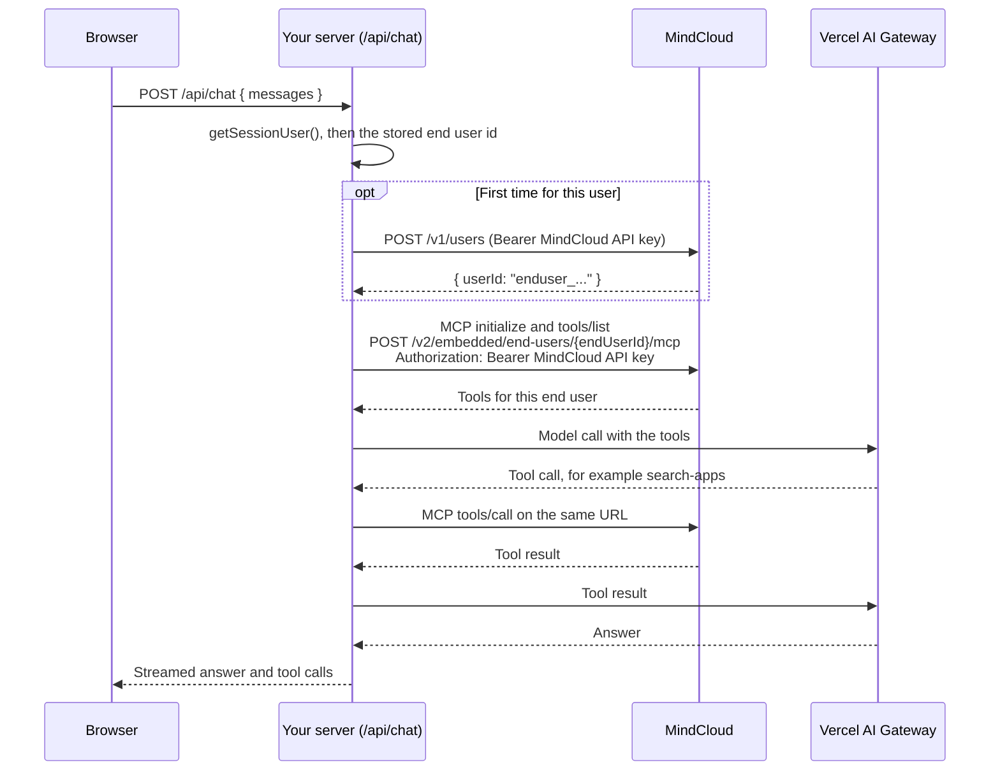

# MindCloud Embedded MCP Example

A small AI agent that runs on your server and uses MindCloud MCP for one of your customers at a time. Your customers are "end users" in MindCloud. The API key controls which tools the agent gets. The agent can search all published apps, but it can act only on this end user's connections. Your MindCloud API key never leaves your server.

The Embedded MCP server is in Beta. The agent gets the tool family Cirra's own agents use: search apps and actions, read an action's schema, run actions on the end user's connections, query stored results, resolve lookups, list the end user's connections, and hand the end user a link to connect an app.

## Quick start

This example is for local use. It has no sign-in check and uses one shared demo user. Do not expose it publicly with live keys. Add authentication, per-user storage, and request limits before deployment.

You need:

1. Node.js 22 or later.
2. A MindCloud organization with Embedded enabled. Your MindCloud representative enables Embedded for your organization.
3. The Embedded MCP server switched on. On the Embedded home page in MindCloud, turn on the **Enable MCP server for AI agents** switch. This one switch turns on the MCP server for your whole organization. Only people who can edit your organization can change it.
4. A MindCloud API key with **Full Access**, from [Settings > API Keys](https://app.mindcloud.co/user/api-keys). This example creates end users, and that needs Full Access.
5. A Vercel AI Gateway key.

Then:

```bash
cp .env.example .env.local   # then fill in MINDCLOUD_API_KEY and AI_GATEWAY_API_KEY
npm install
npm run dev
```

Open **http://localhost:4322**. If the port is busy, run `npx next dev -p 5000` instead.

The Setup tab shows the four steps to connect your own server-side agent: create an API key, create and store an end user, connect the MCP client, and test it. The button after the steps copies the same instructions as Markdown for your AI agent. This example creates and stores its demo end user when the first page loads with a key. The panel next to Chat tells you what is missing. Select a tool name there to open its definition in Tools. Change `.env.local`, then restart `npm run dev`.

## How it works



The MCP client runs on your server, so the model provider sees the tool names and results but never your MindCloud key.

The first page load with a key creates the demo user's end user in MindCloud and stores its id in `data/end-users.json`. Later loads and chat turns reuse that id.

| File | What it does |
| --- | --- |
| `lib/session.js` | Decides who is asking. It is a stub with one demo user. Replace it with your auth. |
| `lib/endUserStore.js` | Maps your user id to the MindCloud end user id, in `data/end-users.json`. In your app this is a column on your users table. Delete `data/end-users.json` to start over. |
| `lib/mindcloud.js` | The base URL, the API key, the MCP URL, and `POST /v1/users`. The only place the key is read. |
| `lib/getMindCloudTools.js` | Connects to the MCP URL with the AI SDK MCP client and returns the tools. It never throws: a failure gives zero tools and a status code. |
| `lib/systemPrompt.js` | The agent's short instructions. |
| `app/api/chat/route.js` | The agent loop: reads `{ messages }`, builds the tools, streams the answer, and closes the MCP client. |
| `app/page.jsx` | Loads the tools for this end user and renders the Chat, Tools, and Setup views. |
| `app/SetupGuide.jsx` | Shows the four integration steps and copies them as Markdown. |
| `app/SetupCodeBlock.jsx` | Colors the setup examples without changing their copied text. |
| `app/setupInstructions.js` | Holds the steps used by both the Setup view and copied Markdown. |
| `app/Workspace.jsx` | Switches views while keeping the Chat state mounted. Chat shortcuts select a tool; returning to Chat clears that selection. |
| `app/ToolsCatalog.jsx` | Groups the live tools and prepares their server-rendered details. |
| `app/ToolBrowser.jsx` | Shows tool choices on the left and the selected tool on the right. The initial state asks the user to select a tool. |
| `app/ToolDetails.jsx` | Shows the live description and input schema, plus a short guide to the expected result. |
| `app/ToolSelectionContext.jsx` | Shares the selected tool between Chat shortcuts and the Tools view. |
| `app/HighlightedCode.jsx` | Highlights tool input notation and JSON schemas with Twinkleplop. |
| `app/ChatClient.jsx` | The chat UI: compact Markdown messages, scrollable tables with row dividers, clickable links, tool rows, and a multiline composer. Raw HTML is disabled; images show their alt text. Enter sends; Shift + Enter adds a line. Blank text parts take no space. |

## The rules

1. **The MindCloud API key stays on your server.** The browser and the model never see it.
2. **The end user id comes from your session.** Never take it from the model, the browser, or tool arguments. MindCloud reads the end user only from the URL, so no tool accepts one.
3. **Create each end user once and store the id.** `POST /v1/users` always creates a new end user. Create a new one only when the MCP URL returns `END_USER_NOT_FOUND`. Do not create one on any other error, such as a 401, a wrong base URL, a rate limit, or an outage.
4. **Show connect URLs exactly as the tool returns them**, and only to the user who asked. Do not rewrite, shorten, or reuse them.

The chat history comes from the browser, so treat it as user input. A user can change what they send, but they cannot change the end user, because your server picks the end user from the session.

## Tools

The server registers only the tools your key's access level allows. **Read Only** gives the five read tools, **Run Workflows** adds `execute-actions` and `resolve-lookup`, and **Full Access** adds `get-connect-url`. Every tool works for the end user in the URL: the search tools see every published MindCloud app, and the other tools see only that end user's connections.

`appRef` is an app slug or id, `actionRef` an action slug or id, and `connectionRef` a connection id from `list-connections`. `cursor` is the value from `meta.pagination` of the previous page.

| Tool | Minimum access | Input | Returns |
| --- | --- | --- | --- |
| `search-apps` | Read Only | `q?`, `actionQ?` (what the user wants to do), `limit?`, `cursor?` | `data`: one item per app with a preview of its actions; `suggestedAction` when `actionQ` has one clear match |
| `search-actions` | Read Only | `appRef`, `q?`, `limit?`, `cursor?` | `data`: the actions of the app's latest published version; with `q` and one clear match, that action's schema too |
| `get-action-schema` | Read Only | `appRef`, `actionRef`, `appVersion?` | The action's arguments and response schema |
| `list-connections` | Read Only | none | `data`: `{ connectionId, appSlug, appName, label, status, connectedOn }` for each of the end user's connections |
| `execute-actions` | Run Workflows | `actions[]` of `{ ref, appRef, appVersion?, actionRef, arguments?, options?, query? { filter, sort, page }, connectionRef?, idempotencyKey? }`, `fields?`, `resultTransformCode?` | One result per `ref`. A large result is stored for 30 minutes and the response carries its `resultSetId` |
| `query-result-set` | Read Only | `resultSetId`, `q?`, `filters?`, `sortBy?`, `fields?`, `aggregate?`, `limit?`, `cursor?` | Rows or aggregates from a stored result |
| `resolve-lookup` | Run Workflows | `appRef`, `actionRef`, `argumentKey`, `q?`, `limit?`, `cursor?`, `connectionRef?` | `{ status, selected?, candidates? }`: the id an argument needs, or the candidates to choose from |
| `get-connect-url` | Full Access | `appRef`, `connectionId?` (repair that connection instead of adding one) | `{ url, appName, expiresAt, singleUse: true }` |

`execute-actions` accepts at most 20 actions per call. Larger batches are rejected before any action runs.

`execute-actions` and `resolve-lookup` run on the end user's connection for the app. With one working connection they use it. With several they return `CONNECTION_CHOICE_REQUIRED` with the ids, and the agent passes one as `connectionRef`. With none they return `NOT_CONNECTED`, and the agent calls `get-connect-url`.

The Chat, Tools, and Setup tabs follow Cirra's sliding underline pattern. Chat and Tools use [Beautiful UI](https://www.beautifului.dev/) as a visual reference. The MindCloud logo and Roobert font files come from the MindCloud website and live in this folder so the example stays standalone. Roobert is used for titles. Chat controls use real state, without demo timers or simulated tool activity. Tools shows the descriptions and input schemas returned by the MCP server for this end user and API key. Its JSON examples show possible successful outputs; expanded tool calls in Chat show actual inputs and outputs. Switching views keeps the current chat mounted.

### Connect links

`get-connect-url` returns a MindCloud page URL with a single-use token that expires in 15 minutes. The end user opens it, clicks **Connect your account**, and connects the app in the MindCloud connect modal. The new connection appears in `list-connections` at once. The tool creates at most 10 links per minute for one end user.

Show the URL exactly as the tool returned it, and only to the user who asked. The link connects an account as that end user, so a link shown to someone else lets them connect their own account for this end user.

A tool result is JSON in one text item:

```json
{ "success": true, "data": [], "meta": {} }
```

## Errors

### Tool errors

A failed tool call sets `isError: true`, and its text is:

```json
{ "success": false, "error": { "code": "APP_NOT_FOUND", "message": "...", "nextStep": "search-apps", "retryable": false } }
```

| Code | `nextStep` | `retryable` | When |
| --- | --- | --- | --- |
| `APP_NOT_FOUND` | `search-apps` | false | No published app matches `appRef`. |
| `ACTION_NOT_FOUND` | `search-actions` | false | The app has no such action. |
| `NOT_CONNECTED` | `get-connect-url` | false | The end user has no connection for the app. |
| `CONNECTION_INVALID` | `get-connect-url` | false | The end user's connection for the app no longer works. The message names its id; pass it as `connectionId` to repair it. |
| `CONNECTION_CHOICE_REQUIRED` | none | false | The end user has several working connections for the app. The message lists their ids; pass one as `connectionRef`. |
| `CONNECTION_NOT_FOUND` | `list-connections` | false | `connectionRef` or `connectionId` is not one of the end user's connections. |
| `VALIDATION_ERROR` | none | false | The arguments do not match the action's schema. The message says which. |
| `RESULT_SET_NOT_FOUND` | none | false | The result set expired or belongs to another end user. Run the action again. |
| `RATE_LIMITED` | none | true | More than 10 connect links in one minute for this end user. |
| `TEMPORARILY_UNAVAILABLE` | none | true | MindCloud could not read the catalog or the end user's connections. |
| `INTERNAL_ERROR` | none | true | Any other failure. The message is always the same. |

`MCP_IDEMPOTENCY_CONFLICT` and `MCP_IDEMPOTENCY_LOCKED` keep their service messages: an `idempotencyKey` was reused with different input, or a run with that key is still in progress. A rejected provider call (for example the app refused the request) comes back as a failed action result with the provider's status and message, the same detail Cirra's agents get.

Input that does not match a tool's schema, and unknown tool names, come back as plain text `isError` results with no code. The model can read them and try again.

### HTTP errors from the MCP URL

These use `{ "success": false, "error": { "code", "message" } }`. They are not JSON-RPC.

| Status | Code | When | What this example does |
| --- | --- | --- | --- |
| 401 | none | The key is missing, invalid, or revoked. | Zero tools. Do not create a key or an end user. |
| 403 | `COMPANY_SCOPE_MISMATCH` | An `X-Company-Id` header names another organization. | Zero tools. |
| 403 | `EMBEDDED_NOT_ENABLED` | Embedded is off for your organization. | Zero tools. |
| 403 | `EMBEDDED_MCP_NOT_ENABLED` | The MCP server switch is off. | Zero tools. |
| 404 | `END_USER_NOT_FOUND` | The end user id is malformed, unknown, or belongs to another organization. All three get the same response. | Creates a new end user and tries once more. |
| 421 or 503 | `COMPANY_REGION_MISMATCH`, `COMPANY_AUTHORIZATION_UNAVAILABLE` | The request reached the wrong region, or the region check failed. | Zero tools. |
| 429 | `RATE_LIMITED` | Too many requests for this key. | Zero tools. |
| 503 | `END_USER_LOOKUP_UNAVAILABLE` | MindCloud could not check the end user. | Zero tools. |

`GET` and `DELETE` on the MCP URL return 405 with a JSON-RPC error body. The server is stateless: every request is a `POST`.

The limit is 600 requests per minute for each API key. One chat turn uses about three requests, plus one for each tool call.

## Hosted MCP connectors

Some model providers can call an MCP server for you, for example Anthropic's MCP connector and OpenAI's remote MCP tool. Then the provider runs the MCP client, so your MindCloud key goes to that provider with every request.

If you do that:

- Create a separate MindCloud key for that URL, with the lowest access level the tools need. **Read Only** gives the five read tools, **Run Workflows** adds `execute-actions` and `resolve-lookup`, and **Full Access** adds `get-connect-url`.
- Every MindCloud key can reach your whole organization through the MindCloud REST API. The access level limits what a key can do, not which end users it can reach.
- Your server still picks the end user id from the session and puts it in the URL.
- The provider must reach the URL on the public internet over `https`, so this does not work with a local MindCloud stack.
- You still need a Full Access key on your server to create end users.

## Use this in your own app

1. **Identity:** replace `lib/session.js` with your session lookup. It is the one place that decides who is asking.
2. **Storage:** replace `lib/endUserStore.js` with a MindCloud end user id column on your users table. `POST /v1/users` always creates a new end user, so lock the user's row (for example with `SELECT ... FOR UPDATE`) around the create call, and store the id before you release the lock. A conditional update alone (`... WHERE mindcloud_end_user_id IS NULL`) keeps one id, but two first requests still create two end users, and one of them stays unused in MindCloud.
3. **Secrets:** keep `MINDCLOUD_API_KEY` in your secret store, on the server only.
4. **Other stacks:** nothing here needs Next.js. Any MCP client that can call a URL with an `Authorization` header works. Connect with the MCP URL for the signed-in user's end user, and create end users only on `END_USER_NOT_FOUND`.
